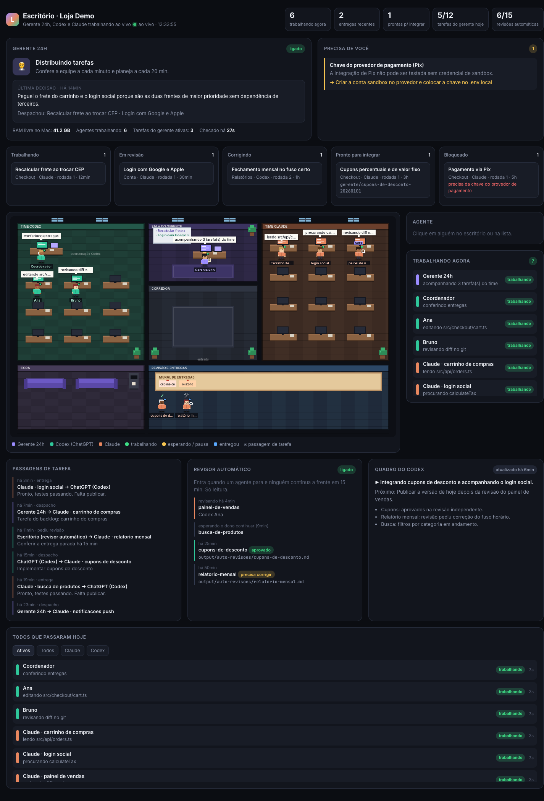

# Escritório de Agentes

Um escritório pixel, ao vivo, para você **ver seus agentes de IA trabalhando juntos**: o Codex (ChatGPT) e o Claude Code aparecem como personagens nas mesas, com balões dizendo o que estão fazendo, quem está trabalhando ou parado e cada tarefa passando de um para o outro.

Além de mostrar, ele tem dois funcionários próprios (opcionais):

- **Revisor automático:** quando um agente termina uma tarefa e ninguém continua aquele trabalho em 15 minutos, um Claude entra **só para ler**, confere o que foi feito de verdade (commits, diff, testes) e deixa um parecer: `APPROVED` ou `NEEDS_FIX`.
- **Gerente 24h:** lê o seu backlog e as suas prioridades, escolhe a próxima tarefa, cria uma área de trabalho isolada (git worktree), despacha um agente, manda revisar, cobra a correção (até 2 rodadas) e deixa o que foi aprovado pronto para você integrar. Você não precisa ficar cobrando ninguém.



> O print acima é do **modo demonstração**, com dados fictícios.

---

## Experimente em 30 segundos (modo demonstração)

Precisa só do [Node.js](https://nodejs.org) 20 ou mais novo. Não tem dependências.

```bash
git clone https://github.com/HUBBER-DIGITAL-ORG/escritorio-de-agentes.git
cd escritorio-de-agentes
npm run demo
```

Abra **http://localhost:4777**. Para forçar o tema escuro ou claro, use `?tema=escuro` ou `?tema=claro`.

---

## Usando com os seus agentes de verdade

O escritório lê, **só em modo leitura**, os registros que o Codex e o Claude Code já gravam no seu computador:

| Fonte | Onde fica | O que mostra |
|---|---|---|
| Codex (ChatGPT desktop / CLI) | `~/.codex/sessions/` | coordenador, subagentes, comandos, edições, mensagens entre agentes |
| Claude Code | `~/.claude/projects/` | sessões abertas no seu projeto, ferramentas usadas, relatório final |
| Quadro do Codex (opcional) | `.codex/live-work-status.json` no projeto | "fazendo agora", "próximo passo", "recentes" |

1. Copie o exemplo de configuração e aponte para a pasta do seu projeto:

```bash
cp config.example.json config.json
```

```json
{
  "nome": "Meu Projeto",
  "projeto": "~/projetos/meu-projeto"
}
```

2. Rode:

```bash
npm start
```

Todo agente (Codex ou Claude) que trabalhar dentro dessa pasta aparece no escritório.

**Como ele entende "frentes" de trabalho:** se os seus agentes trabalham em git worktrees dentro do projeto (por exemplo `meu-projeto/wt-carrinho-20260101/`), cada worktree vira uma frente. É assim que ele sabe quem terminou o quê e se alguém já revisou.

### Status dos personagens

| Status | Regra | Onde aparece |
|---|---|---|
| trabalhando | atividade nos últimos 75s | na mesa, com balão |
| esperando | comando longo rodando (testes, build) | na mesa, com "…" |
| pausa | parado há até 20 min | na copa (z) |
| entregou | terminou e devolveu relatório | no mural de entregas (✓ ou 🛠) |
| saiu | parado há mais de 20 min | some do mapa, fica na lista |

---

## Revisor automático

Ligado por padrão (`"revisor": { "ligado": true }`).

- Espera **15 min** depois que uma frente para. Se o dono dela (ou outro agente) continuar, ele não entra.
- Roda o Claude com permissão **só de leitura**: Read, Grep, Glob, `git log/diff/show/status` e os comandos de teste de `comandosTeste`. Editar, escrever arquivo, acessar a internet e criar subagentes ficam **bloqueados**.
- Grava o parecer em `output/auto-revisoes/<frente>-<data>.md` e um índice em `INDEX.jsonl`.
- Limites: 2 ao mesmo tempo, 15 por dia, 25 min cada. Não revisa de novo a mesma frente no mesmo commit.
- Para pausar: crie o arquivo `REVISOR_DESLIGADO` na pasta do escritório.

Dica: coloque no `AGENTS.md` do seu projeto algo como *"antes de retomar ou encerrar uma frente, leia o parecer mais recente em output/auto-revisoes/; se for NEEDS_FIX, corrija"*. Assim o Codex passa a agir sobre os pareceres.

## Gerente 24h

**Desligado por padrão.** Ele gasta a cota das suas assinaturas, então ligue de propósito: `"gerente": { "ligado": true }`.

Você define o que importa em dois arquivos (veja `examples/`):

- `prioridades.json`: as frentes em ordem de prioridade, com o objetivo de cada uma e os ids do backlog.
- `backlog.json` (na pasta do projeto): a lista de itens com `id`, `titulo`, `estado`, `detalhe` e `proximo`.

A cada ciclo ele:

1. Confere RAM livre, quantos agentes já estão trabalhando e o limite do dia.
2. Pede a um Claude **só de leitura**, olhando o código, para escolher até 2 tarefas pequenas (cerca de 40 min cada), com critérios de aceite testáveis. Ele **desvia** das frentes que outros agentes mexeram nas últimas 3h e **não repete** itens que já têm tarefa ativa, pronta ou bloqueada.
3. Cria um worktree `wt-<tarefa>-AAAAMMDD` na branch `gerente/<tarefa>-AAAAMMDD` a partir de `baseRef` e despacha o executor (Claude por padrão, ou Codex).
4. Quando o executor termina, manda para o revisor independente. Se vier `NEEDS_FIX`, manda corrigir (até 2 rodadas).
5. Se aprovado, faz commit na branch e anota em `output/gerente/PRONTOS-PARA-INTEGRAR.md`.
6. O que depende de você (login, credencial, dinheiro, decisão de produto) aparece em **"Precisa de você"**.

O gerente **nunca** faz merge na main, push, deploy, nem envia mensagens.

---

## Segurança e custo (leia antes de ligar o gerente)

- **Usa as suas assinaturas.** O revisor e o gerente chamam `claude` (e opcionalmente `codex`) já logados no seu computador. O código **remove** `ANTHROPIC_API_KEY`/`OPENAI_API_KEY` do ambiente dos agentes, para não cair numa cobrança por API sem você perceber.
- **Mais agentes esgotam a cota mais rápido.** Comece com os limites padrão e acompanhe.
- **Memória do computador:** cada agente rodando testes usa de 2 a 3 GB de RAM. O gerente não despacha se sobrar menos que `minRamGB`.
- **Nada sai da sua máquina.** O servidor escuta só em `127.0.0.1`. Para ver do celular, use um túnel privado (Tailscale, por exemplo), nunca uma porta aberta na internet.
- Os registros do Codex/Claude podem conter trechos do seu código e das suas conversas. **Não publique prints do modo real sem conferir.**

## Deixar rodando sempre (macOS)

Há um exemplo de `launchd` em `examples/com.escritorio-de-agentes.plist`. Troque os caminhos e rode:

```bash
cp examples/com.escritorio-de-agentes.plist ~/Library/LaunchAgents/
launchctl bootstrap gui/$(id -u) ~/Library/LaunchAgents/com.escritorio-de-agentes.plist
```

No Linux, use um serviço do systemd com `node server.mjs`.

## Configuração completa

| Campo | Padrão | Para quê |
|---|---|---|
| `nome` | nome da pasta | título do escritório |
| `projeto` | pasta atual | pasta onde os agentes trabalham |
| `repo` | `.` | repositório git onde o gerente cria worktrees |
| `porta` | `4777` | porta local |
| `janelaHoras` | `12` | quantas horas de sessões mostrar |
| `baseRef` | `main` | commit base das tarefas do gerente |
| `prefixoWorktree` | `wt-` | prefixo dos worktrees |
| `backlog` / `prioridades` | `backlog.json` / `prioridades.json` | entradas do gerente |
| `comandosTeste` | node/tsc/eslint/pytest… | comandos que revisor e executores podem rodar |
| `revisor.*` | ligado, 15 min, 15/dia, 2 paralelos | limites do revisor |
| `gerente.*` | desligado, 2 paralelos, 12/dia, 2 GB, 20 min | limites do gerente |

## Como funciona por dentro

- `server.mjs`: lê o fim (e o começo) de cada arquivo de sessão a cada 3 s, monta o estado e envia ao navegador por Server-Sent Events.
- `revisor.mjs`: decide quando uma frente precisa de revisão e dispara `claude -p` só de leitura.
- `gerente.mjs`: o ciclo de planejar, despachar, revisar, corrigir e entregar.
- `demo.mjs`: dados fictícios para o modo demonstração.
- `public/index.html`: a interface, com o escritório desenhado em `<canvas>`, sem bibliotecas.

Inspirado na ideia de "escritórios pixel" de agentes, como o Pixel Agents. Este projeto é independente e escrito do zero para acompanhar **Codex e Claude ao mesmo tempo**.

## Licença

MIT. Feito pela [Hubber Digital](https://github.com/HUBBER-DIGITAL-ORG).
